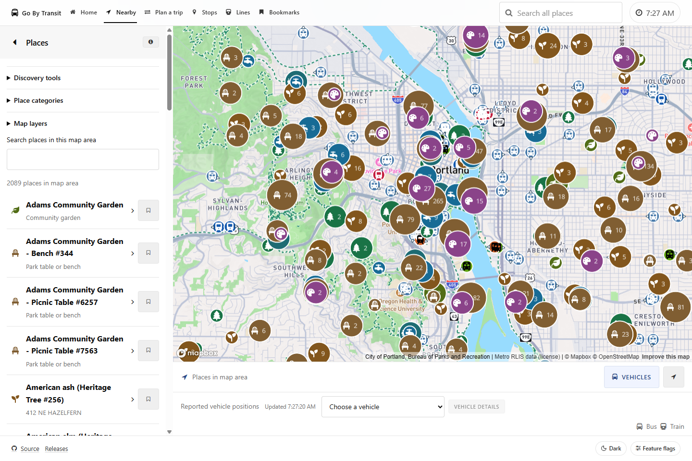
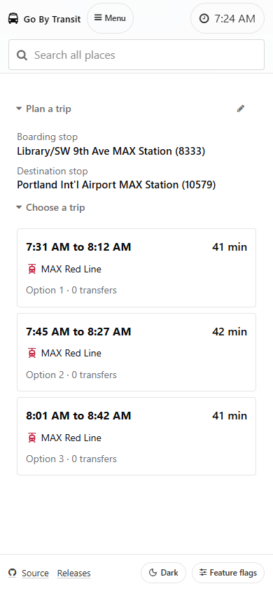

# Go By Transit

[](https://github.com/wintermuted/trimet-arrivals/actions/workflows/deploy-pages.yml) [](https://github.com/wintermuted/trimet-arrivals/actions/workflows/deploy-pr-preview.yml)

Explore Portland by transit: find TriMet stops and arrivals, plan trips, follow
reported bus and train positions, and discover places along the way.
Built with TypeScript, React, Redux, and Mapbox.

**[Open the app](https://wintermuted.github.io/trimet-arrivals/)** · **[Documentation](docs/README.md)** · [Report a bug](https://github.com/wintermuted/trimet-arrivals/issues/new?template=bug_report.md)

## What you can do

- Find nearby stops using device location, a map-area search, or a dropped pin.
- Compare trips, see boarding and arrival times, and inspect walking/transit legs.
- View reported vehicles and follow a vehicle's current run.
- Explore Portland places, save favorites, share map views, and find places along a trip.
- Keep stop/route bookmarks and switch between light and dark themes.

## Screenshots

### Discover places on the map



Places on desktop with the **Park day** discovery preset. Categories, search,
and optional reference layers help narrow the map and results.

### Plan a trip on mobile



The mobile planner compares departure times, journey durations, and transfers.
Times and vehicle positions in screenshots are examples captured from the app,
not current travel information.

## Run locally

Use Node.js **26.13.1** (see [`.nvmrc`](.nvmrc)) and npm:

```powershell
npm ci
npx nx run-many -t watch
```

Open the local URL printed by Vite. `npm run watch` also works.
See [development](docs/development.md) for CI, test commands, geometry exports,
and GitHub Copilot app setup.

## Guides

| Using the app | Developing and maintaining it |
| --- | --- |
| [Nearby, stops, and arrivals](docs/nearby.md) | [Development](docs/development.md) |
| [Trip planning and walking estimates](docs/trip-planning.md) | [Design system](docs/design-system.md) |
| [Vehicles and trip following](docs/vehicles.md) | [Place-data maintenance](docs/place-data.md) |
| [Places and map layers](docs/places.md) | [All documentation](docs/README.md) |

## Data, privacy, and limitations

Arrival predictions and reported vehicle positions can be delayed or unavailable.
Place snapshots are not live hours, verified entrances, or guarantees of public
access. Walking estimates are opt-in and send routing coordinates to Mapbox;
they are not accessibility guidance. See the linked guides for details.

The app code is MIT-licensed. Place datasets retain their own attribution and
license terms in the [data notice](public/data/places/NOTICE.txt) and
[maintenance guide](docs/place-data.md#snapshot-locations-attribution-and-licenses).
For vulnerability reporting, see the [security policy](SECURITY.md).
