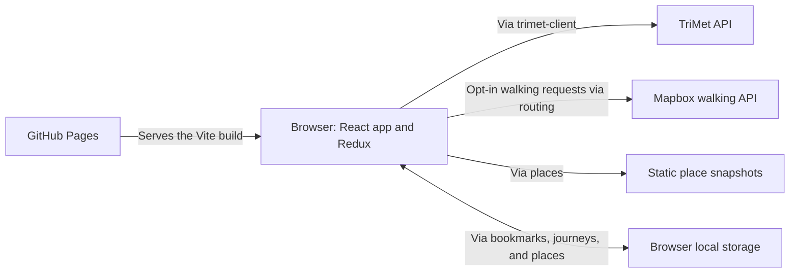
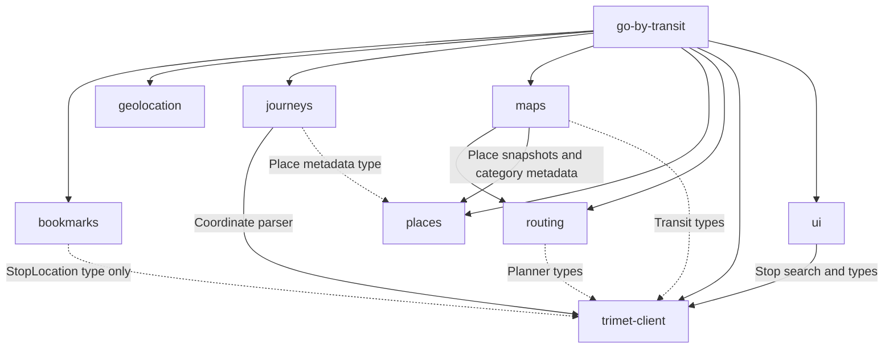

# Architecture

[Documentation](README.md) / [Project home](../README.md)

## Repository and application tenants

Overworld is the repository and shared tooling workspace. Go By Transit
(`@overworld/go-by-transit`) is its first application tenant. A tenant here is
an application workspace, not a customer account, authentication boundary, or
runtime tenancy service.

Application tenants live in `packages/applications/<app-name>` and consume
public `@overworld/*` library APIs. Each tenant owns its navigation, state
orchestration, service configuration, and product-specific UX. Shared libraries
must not depend on tenant source. Domain-specific libraries such as
`trimet-client` remain transit-specific; other tenants can choose only the
capabilities they need. All packages are currently private workspaces.

Only Go By Transit exists today. Root Vite configuration, HTML, public assets,
and Pages workflows still target that tenant. Adding another application does
not automatically provide a build target, deployment, or runtime tenant selector;
define its entry/assets and execution/deployment wiring when onboarding it.

## Go By Transit at runtime

GitHub Pages serves the Vite build as a static site. The React app runs in the
browser and coordinates requests to external services and reads and writes to
browser storage. There is no Go By Transit application server.

## Workspace packages

Overworld uses npm workspaces and Nx to host apps and reusable libraries.
Go By Transit and its integration tests live
in `packages/applications/go-by-transit/src`. Vite's entry HTML, `public/`, the `build/` output, and
the npm and Nx commands stay at the repository root.

Workspace folders are grouped by capability domain. Packages use the
`@overworld` namespace:

| Domain folder | Workspaces |
| --- | --- |
| `packages/applications` | `go-by-transit` |
| `packages/api` | `trimet-client`, `geolocation`, `places` |
| `packages/util` | `bookmarks`, `journeys`, `routing` |
| `packages/geography` | `maps` |
| `packages/presentation` | `ui` |

Domain folders are organizational containers, not packages. Maps and UI retain
their existing cross-domain public subpaths rather than being split further.
`api` groups service, device-location, and place-data providers; `util` groups
reusable persistence, journey models, and routing helpers. These folders do not
change package APIs or introduce new dependency restrictions.

Runtime dependencies belong to the leaf workspaces that import them, not the
repository root. The app declares its shared-workspace and browser dependencies;
libraries declare their own imports and retain host-provided peer contracts.
The root keeps shared build/test/release tooling in `devDependencies` and its
explicit Nx dependency on the app for orchestration.

Arrows point from a package to the packages it uses. Dotted arrows represent
type-only dependencies, which do not load the other package at runtime.

| Package | Description |
| --- | --- |
| [`@overworld/go-by-transit`](../packages/applications/go-by-transit/README.md) | The Go By Transit web app: screens, navigation, Redux state, and map rendering. |
| [`@overworld/bookmarks`](../packages/util/bookmarks/README.md) | Browser storage for stop and route bookmarks, sections, route groups, and shortcuts, plus optional React shortcut subscriptions. |
| [`@overworld/geolocation`](../packages/api/geolocation/README.md) | Browser device-location requests and shared React location subscription. |
| [`@overworld/journeys`](../packages/util/journeys/README.md) | Recent journey storage, planner endpoint model, parsing, labels, and query serialization. |
| [`@overworld/maps`](../packages/geography/maps/README.md) | Mapbox lifecycle and transit overlays, plus React place/reference and itinerary renderers through `maps/places` and `maps/planner`. |
| [`@overworld/places`](../packages/api/places/README.md) | Portland place discovery, saved places, and reference-layer snapshots and loading. |
| [`@overworld/routing`](../packages/util/routing/README.md) | Walking client and React estimate hook, route assets, planner path assembly, and vehicle interpolation. |
| [`@overworld/trimet-client`](../packages/api/trimet-client/README.md) | TriMet clients, stop catalog search, freshness rules, vehicle trip-leg derivation, and optional React catalog/vehicle hooks. |
| [`@overworld/ui`](../packages/presentation/ui/README.md) | Time settings and router-free transit/arrival, itinerary/directions, disclosure, alert, vehicle-progress, and stop-search presentation. |

## App and library boundaries

Import from public package entry points rather than reaching into `src/`.
Shared packages do not import app code. The app owns Redux, navigation and URL
state, bookmark screens, planner colors, configured catalog requests and caching,
configured requests, viewport event adapters, and map/screen coordination.

Future apps belong alongside Go By Transit in `packages/applications` and
consume these public library entry points. Keep app-specific configuration and
orchestration in each app rather than coupling libraries to a particular host.

Go By Transit's `BookmarksProvider` owns stop and route bookmarks, collections,
route membership, and the collection-name draft through React Context and
`useReducer`. It initializes from `@overworld/bookmarks` once per app mount;
navigation no longer dispatches bookmark initialization. A separate command
context provides stable mutation callbacks. Transit requests, polling, arrivals,
and map/view coordination remain on Redux and sagas.

Bookmark mutations persist through the existing storage APIs before publishing
state. A failed write leaves the affected domain unchanged and displays an
error. Route/collection deletion clears route-group membership first; if a later
write fails, state reflects the successful cleanup without claiming deletion.
Initialization reads each storage domain independently, preserving malformed
content and reporting errors without hiding valid bookmarks in other domains.
Storage keys and payload formats are unchanged. Bookmark state has no new
cross-tab synchronization; the existing shortcut subscriptions remain separate.

The app supplies the TriMet URL, app ID, and `REACT_APP_USE_FIXTURE` setting
for requests that support fixtures. For route configuration, only the
all-routes request uses fixtures. Trip planning uses the browser's `DOMParser`.
The app supplies the Mapbox walking token. The `routing/react` entry owns the
walking-estimate hook; `trimet-client/react` owns catalog loading/refresh,
vehicle polling, and trip-progress hooks with injected requests. Their main
entries remain React-free.
The `maps` package owns map creation, theme synchronization, current-location
layers, and transit overlays. Access tokens, DOM theme observation, initial
camera options, route display names, and configured providers stay app-owned.
Route geometry loading and planner path assembly live in `routing`; the app
supplies asset URLs, request functions, and color policy. `maps/places` owns
place/reference rendering, and `maps/planner` owns itinerary layers, stop
markers, highlighting, and camera fitting. Snapshot loading, filter state,
configured path providers, discovery controls, and screen coordination stay
in the app.
Transit UI components do not import a router; app wrappers retain navigation
and the planner stop picker's common-place presets.
`ui/transit` owns arrival rows/tables and expand/collapse presentation; app
adapters supply route links and the existing distance-formatting policy.
`ui/search` owns stop-search matching, exact-ID priority, bounded results,
query and loading/error/partial states, and responsive presentation. Catalog
requests/caching and planner, arrival, and footer links stay app-owned.
`bookmarks/react` owns shortcut reads, writes, error state, and same/cross-tab
subscriptions; the bookmark provider, screens, and planner state stay in
the app. Its main entry remains React-free.
`trimet-client` owns pure vehicle trip-leg derivation, and `ui/vehicles` owns
progress timelines and map-view controls. Feed orchestration, configured
polling, route names, header/back navigation, focus, and timezone remain
app-owned.
`ui/journeys` owns itinerary/directions presentation with injected transit
colors; `ui/alerts` owns cards with supplied loading content and link renderers.
Alert fetching/scoping, journey selection, focus orchestration, and navigation
remain app-owned. Shared disclosure Sass mixins are exported by `ui`.
Endpoint rules live in `journeys`, while place verification and planner state
remain app-owned.
`geolocation` uses browser types without a TriMet dependency; default Portland
coordinates and geolocation fixture selection remain in the app.

See [development](development.md#workspace-commands) for package tests and Nx
affected-project commands.
