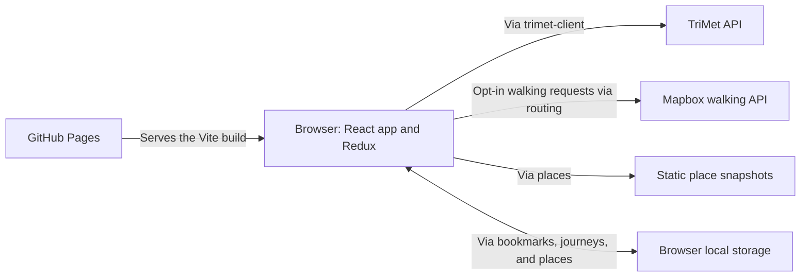
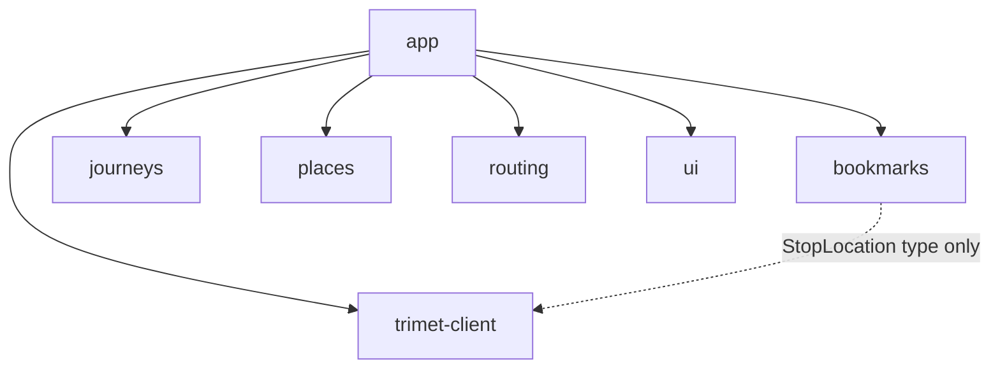

# Architecture

[Documentation](README.md) / [Project home](../README.md)

## App at runtime

GitHub Pages serves the Vite build as a static site. The React app runs in the
browser and coordinates requests to external services and reads and writes to
browser storage. There is no Go By Transit application server.

## Workspace packages

Go By Transit uses npm workspaces and Nx. The app and its integration tests live
in `packages/app/src`. Vite's entry HTML, `public/`, the `build/` output, and
the npm and Nx commands stay at the repository root.

Arrows point from a package to the packages it uses. The dotted arrow is a
type-only dependency: `bookmarks` uses the TriMet stop type, not its API client
at runtime.

| Package | Description |
| --- | --- |
| [`@trimet-arrivals/app`](../packages/app/README.md) | The Go By Transit web app: screens, navigation, Redux state, and map rendering. |
| [`@trimet-arrivals/bookmarks`](../packages/bookmarks/README.md) | Browser storage for stop and route bookmarks, sections, route groups, and shortcuts. |
| [`@trimet-arrivals/journeys`](../packages/journeys/README.md) | Browser storage for the trip planner's recent stop-to-stop journeys. |
| [`@trimet-arrivals/places`](../packages/places/README.md) | Portland place discovery, saved places, and reference map layers. |
| [`@trimet-arrivals/routing`](../packages/routing/README.md) | Mapbox walking estimates and route geometry with request caching. |
| [`@trimet-arrivals/trimet-client`](../packages/trimet-client/README.md) | TriMet API clients, stop catalog indexing and search, and vehicle freshness rules. |
| [`@trimet-arrivals/ui`](../packages/ui/README.md) | Shared React time display settings and context. |

## App and library boundaries

Import from public package entry points rather than reaching into `src/`.
Shared packages do not import app code. The app owns Redux, navigation and URL
state, bookmark screens, planner colors, stop catalog fetching and caching,
vehicle polling, and map rendering.

The app supplies the TriMet URL, app ID, and `REACT_APP_USE_FIXTURE` setting
for requests that support fixtures. For route configuration, only the
all-routes request uses fixtures. Trip planning uses the browser's `DOMParser`.
The app also supplies the Mapbox walking token and owns the walking React hooks
and map layers.

See [development](development.md#workspace-commands) for package tests and Nx
affected-project commands.
