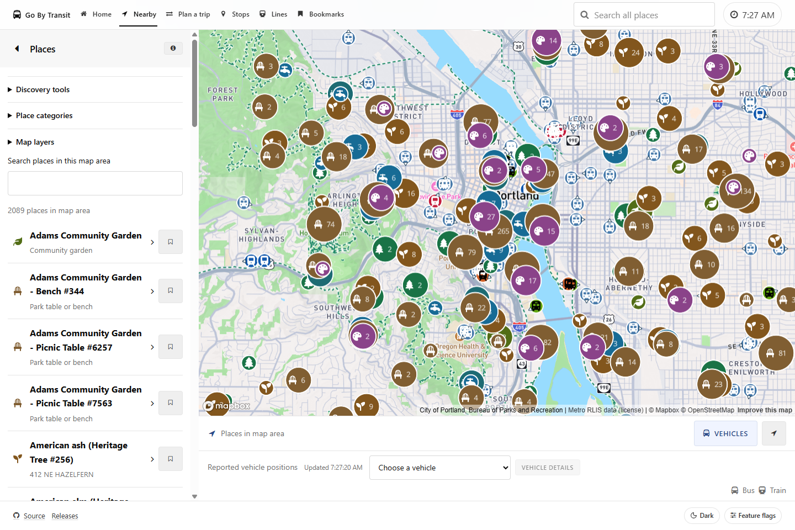
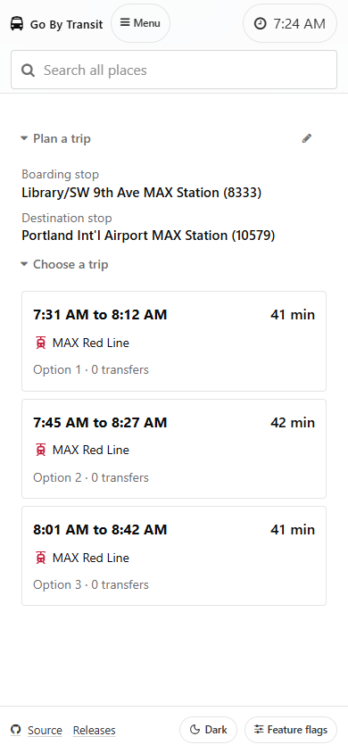

# Go By Transit

Go By Transit (`@overworld/go-by-transit`) is one application tenant of
[Overworld](../../../README.md). Explore Portland by transit: find TriMet stops
and arrivals, plan trips, follow reported bus and train positions, and discover
places along the way. Built with TypeScript, React, and Mapbox.

**[Open Go By Transit](https://wintermuted.github.io/overworld/)** ·
**[User guides](../../../docs/README.md#using-go-by-transit)** ·
[Report a bug](https://github.com/wintermuted/overworld/issues/new?template=bug_report.md)

## What you can do

- Find nearby stops using device location, a map-area search, or a dropped pin.
- Compare trips, see boarding and arrival times, and inspect walking/transit legs.
- View reported vehicles and follow a vehicle's current run.
- Explore Portland places, save favorites, share map views, and find places along a trip.
- Keep stop/route bookmarks and switch between light and dark themes.

## Screenshots

### Discover places on the map



Places on desktop with the **Park day** discovery preset. Categories, search,
and optional reference layers help narrow the map and results.

### Plan a trip on mobile



The mobile planner compares departure times, journey durations, and transfers.
Times and vehicle positions in screenshots are examples captured from the app,
not current travel information.

## Development and ownership

Run these commands from the Overworld repository root:

```powershell
npm ci
npm run watch
```

This tenant owns screens, navigation, React state, map/screen coordination, and
service configuration. It consumes reusable `@overworld/*` libraries through
their public entry points; those libraries do not depend on this tenant.
Vite's HTML entry and `public/` assets currently live at the repository root,
and the Pages workflows deploy this tenant, not a multi-app shell.
See [development](../../../docs/development.md) for setup and deployment and
[architecture](../../../docs/architecture.md) for app/library boundaries.

## Guides

| Guide | Focus |
| --- | --- |
| [Nearby, stops, and arrivals](../../../docs/nearby.md) | Location, stops, routes, and departures. |
| [Trip planning and walking estimates](../../../docs/trip-planning.md) | Itineraries, directions, recent trips, and routing consent. |
| [Vehicles and trip following](../../../docs/vehicles.md) | Reported positions and following a run. |
| [Places and map layers](../../../docs/places.md) | Portland discovery, saved places, and shared views. |
| [Design system](../../../docs/design-system.md) | This tenant's shell, theme, and map presentation. |
| [Place-data maintenance](../../../docs/place-data.md) | Snapshots, refreshes, attribution, and licenses. |

## Data, privacy, and limitations

Arrival predictions and reported vehicle positions can be delayed or unavailable.
Place snapshots are not live hours, verified entrances, or guarantees of public
access. Walking estimates are opt-in and send routing coordinates to Mapbox;
they are not accessibility guidance. See the linked guides for details.

App code is MIT-licensed. Place datasets retain their own attribution and license
terms in the [data notice](../../../public/data/places/NOTICE.txt) and
[maintenance guide](../../../docs/place-data.md#snapshot-locations-attribution-and-licenses).
For vulnerability reporting, see Overworld's [security policy](../../../SECURITY.md).
